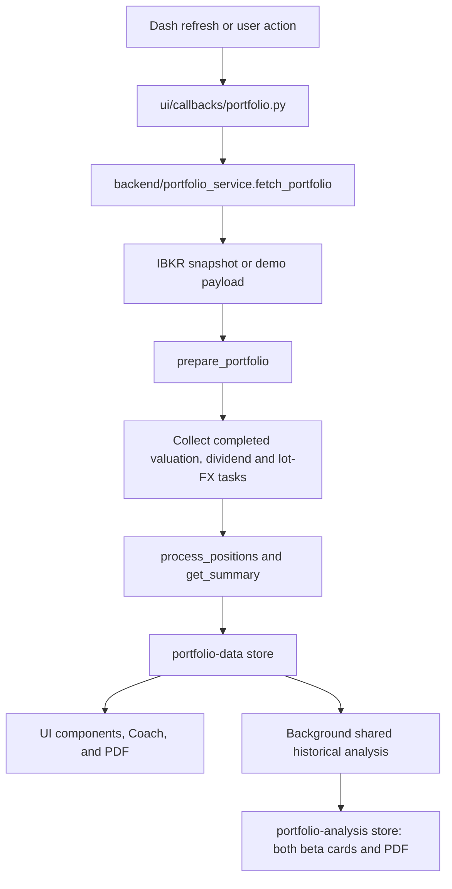

# Finding and changing the code

This is one Python/Dash application, designed for one owner and one process.
`backend/` fetches, stores, and calculates data. `ui/` displays it. Backend code
never imports Dash or UI modules; `tests/test_architecture.py` checks that rule.

## Start and check

Use Python 3.12. From the repository root:

```bash
python -m pip install -r requirements.txt ruff
python main.py --demo
```

Open http://localhost:8050. The demo supplies synthetic holdings; market data
and optional AI still use external providers. `python main.py` connects to TWS
or IB Gateway. `config.yaml` contains the settings; environment variables take
priority. `OPEN_BROWSER=0` disables automatic browser opening.

Before committing:

```bash
ruff check .
python smoke_test.py
python -m pytest -q
```

The tests use fixtures and mocked provider responses. They do not validate a
live brokerage account. CI runs all three checks on Python 3.12. Read
[DATA_AND_FLEX.md](DATA_AND_FLEX.md) for current valuation, shared beta and
automatic trade-history setup.

## Directory map

```text
main.py                     Start logging, broker connection, and web server
config.py / config.yaml     Configuration and shared runtime-data location
scripts/                    Optional Docker installers and launchers
backend/
  portfolio_service.py      Fetch → enrich → calculate → return snapshot
  portfolio/
    positions.py            Holding calculations, gross allocation, daily P&L choice
    valuation.py            Current and compatible dated base-currency valuations
    analysis.py             Shared signed account-equity beta, risk and scenarios
    fx.py                   Daily FX, FIFO lots, since-purchase FX, base valuation
    history.py              Historical holdings backcast, comparison series, and ECB €STR
    risk.py                 Pure risk metrics, benchmark FX conversion, and risk-free averaging
    exposure.py             Shared sector/country aggregation
    fundamentals.py         Investment signal labels from fetched fundamentals
    report_data.py          PDF data and performance comparisons
  providers/
    ibkr.py                 Broker connection, retries, snapshot normalization
    flex.py                 Background Flex reports and authoritative lot reconciliation
    demo.py                 Synthetic demo holdings and explicit demo FX lots
    market_data.py          Yahoo symbols, prices, fundamentals, sectors, earnings
    fx_history.py           Historical FX lookup and trade-lot orchestration
    dividends.py            Yahoo dividend fallback
    news.py                 Headline retrieval and feed parsing
    valuation.py            Macro data retrieval and valuation classifications
    ai.py                   Optional AI providers and portfolio context
  coaching/
    scenarios.py            Preset answers as ordinary dictionaries
    conversations.py        Conversation/thread operations
  storage/
    trades.py               CSV parsing and atomic trade-history persistence
    cache.py                Shared timed cache
  network.py                Existing retry and parallel-fetch helpers
  schemas.py                Core payload fields and their units
ui/
  app.py                    Create Dash, register callbacks and health endpoint
  layout.py                 Page structure and stores
  callbacks/                Inputs, outputs, browser state, loading/error handling
  components/               Cards, tables, charts, chat bubbles, and panels
  reports/                  PDF document and chart rendering
  helpers.py / styles.py    Shared presentation helpers and styles
  errors.py / health.py     Render error boundary and HTTP health endpoint
  assets/                   CSS and branding
tests/                     Regression, integration, and architecture checks
docs/                      Setup, this map, and audit history
```

Do not put financial formulas in a rendering component. Do not add a second
implementation for a PDF or Coach answer: they should consume the same backend
result. Keep related functions together; a new class or framework is not needed
just to connect two functions.

## Follow one portfolio refresh



`fetch_portfolio()` returns `None` for no broker snapshot, `{}` for a connected
account without positions, and a dictionary for a populated portfolio. The
payload carries positions, summary, account, dividends, and broker trades.

Optional broker/provider requests run in background tasks. The existing
four-second poll collects results without waiting for Yahoo history or Flex.
An unfinished task must not invent a numeric answer; missing trade-lot FX never
enables an aggregate fallback. Current valuation needs no previous FX close.

## Where to change what

| Change | Start here | Relevant checks |
|---|---|---|
| Since-purchase FX formula | `backend/portfolio/fx.py:total_fx_from_trades` | `tests/test_fx_trade_lot_precedence.py`, `tests/test_fx_impact.py` |
| Missing/slow FX task | `backend/portfolio_service.py:prepare_portfolio` | `tests/test_architecture.py` |
| Broker fields or quotes | `backend/providers/ibkr.py` | Live TWS validation as well as unit tests |
| Valuation, exposure, beta | `backend/portfolio/valuation.py`, `analysis.py`, `positions.py` | `tests/test_account_analysis.py`, `tests/test_risk_page.py` |
| Sector/geography calculation | `backend/portfolio/exposure.py` | `tests/test_audit_regressions.py`, `tests/test_architecture.py` |
| Card/table text or formatting | `ui/components/summary.py` | UI regression tests |
| Click, sort, upload behavior | `ui/callbacks/detail.py` | `tests/test_audit_regressions.py`, `tests/test_trade_storage.py` |
| Position detail appearance | `ui/components/position.py` | App and component checks |
| Historical performance | `backend/portfolio/analysis.py`, `history.py`, `ui/callbacks/performance.py` | `tests/test_performance.py` |
| Macro sources or thresholds | `backend/providers/valuation.py` | `tests/test_audit_regressions.py`, smoke checks |
| Preset Coach calculations | `backend/coaching/scenarios.py` | Test returned answer data before testing rendering |
| Coach appearance | `ui/components/scenarios.py`, `chat.py`, `coach_panel.py` | `tests/test_coach.py`, `tests/test_news.py` |
| AI request/context | `backend/providers/ai.py` | `tests/test_ai_provider.py`, `tests/test_news.py` |
| PDF content/layout | `ui/reports/pdf.py:build_pdf` | `tests/test_pdf_report.py`, PDF regression checks |
| CSS, colors, branding | `ui/assets/custom.css`, `ui/styles.py` | App asset checks and browser inspection |
| CSV or persistence | `backend/storage/trades.py` | `tests/test_trade_storage.py` |
| Automatic broker history | `backend/providers/flex.py` | `tests/test_flex_history.py` |

## Calculation conventions and unavailable data

- **Units:** raw TWS position value/P&L remains labelled “TWS units.” Holding
  weights use separately verified native share prices, contract multipliers,
  and current account-currency FX. Compatible dated values are accepted up to
  five days with a source/date; a configured display rate never verifies a value.
  Missing verification suppresses affected charts and beta.
- **Since-purchase FX:** sum each reconciled open lot's signed `quantity × multiplier ×
  current native price × (FX now − purchase-date FX)`. Daily closing purchase
  rates make this an estimate; reported opening-trade FX takes priority.
  Authoritative Flex lots and execution coverage are required; a matching
  quantity alone does not establish complete history. Unreconciled history
  suppresses this estimate only. The
  price/FX interaction is assigned to FX. Demo estimates use explicit synthetic
  opening lots, not the removed average-cost formula.
- **Daily P&L:** zero is a valid broker result. Only `None` permits a calculated
  fallback, and that fallback requires verified account-base units.
- **Beta:** one historical result supplies both pages and the PDF. Signed
  current stock/ETF values divided by positive account equity weight returns;
  foreign cash contributes FX returns. Shorts and leverage are retained. At
  least 30 common daily returns are required; the shared window is 1Y/3Y/5Y.
- **Exposure:** sector weights are fractions. Missing ETF sector coverage is
  assigned to Unknown. UI, Coach, and PDF use the same aggregation.
- **Performance:** fixed current signed exposures produce account-equity
  scenarios from dividend-adjusted historical prices and daily FX, including
  foreign cash. This is not an account ledger; past trading, borrowing,
  financing and transaction costs are excluded.
- **Buffett ratio:** matched annual observations from World Bank
  [listed domestic market capitalization in current USD](https://data.worldbank.org/indicator/CM.MKT.LCAP.CD)
  and [GDP in current USD](https://data.worldbank.org/indicator/NY.GDP.MKTP.CD).
  The UI states the observation year. This is not a live market estimate.

## Optional Docker scripts

These are not needed for `python main.py`. From a source checkout, use
`bash scripts/start.sh`, `bash scripts/stop.sh`, or `bash scripts/update.sh`.
Windows users can run the corresponding `scripts\start.bat`, `stop.bat`, and
`update.bat` files. The launchers locate Compose relative to their own location,
so the terminal's current folder does not matter.

`install.sh` and `install.ps1` also live in `scripts/`. They create a separate
Docker installation under the user's home directory, retaining its existing
flat layout. The release ZIP likewise keeps start/stop/update files beside
Compose; the release workflow copies them from `scripts/` in the source tree.

## Persistence and deployment

`config.DATA_DIR` resolves to `IBKRDASH_DATA_DIR`, or the repository's `data/`
folder. Cache and uploaded trades share that location. Files stay outside source
packages. Saves use a temporary sibling file, flush it, and atomically replace
the original. A process-local lock protects concurrent uploads and deletion;
this remains a single-process application.

Docker Compose binds port 8050 to localhost and mounts the named
`dashboard-data` volume at `/app/data`. Recreating the container preserves the
volume; `docker compose down -v` deletes it. Private data and local environments
are excluded from the build context.

**Before updating an older container without a volume**, copy its data out:

```bash
docker cp ibkrdash:/app/data ../ibkrdash-data-backup
```

Keep the backup, rebuild/recreate the container, then restore the uploaded JSON:

```bash
docker cp ../ibkrdash-data-backup/uploaded_trades.json ibkrdash:/app/data/uploaded_trades.json
docker exec --user root ibkrdash chown -R appuser:appuser /app/data
```

Do this before entering new trades in the updated container. Never commit the
backup or share it in a Docker build context. Live TWS, real provider responses,
and the Docker build/runtime still need environment-specific verification.

## Graphify

From the repository root:

```bash
graphify extract . --code-only
graphify query "prepare_portfolio"
```

After source changes, use `graphify update .`. `.graphifyignore` excludes local
data, environments, caches, binary artwork, and generated output. The graph is
a navigation aid; current source and tests decide behavior. `graphify-out/` is
local generated output and is not committed.
