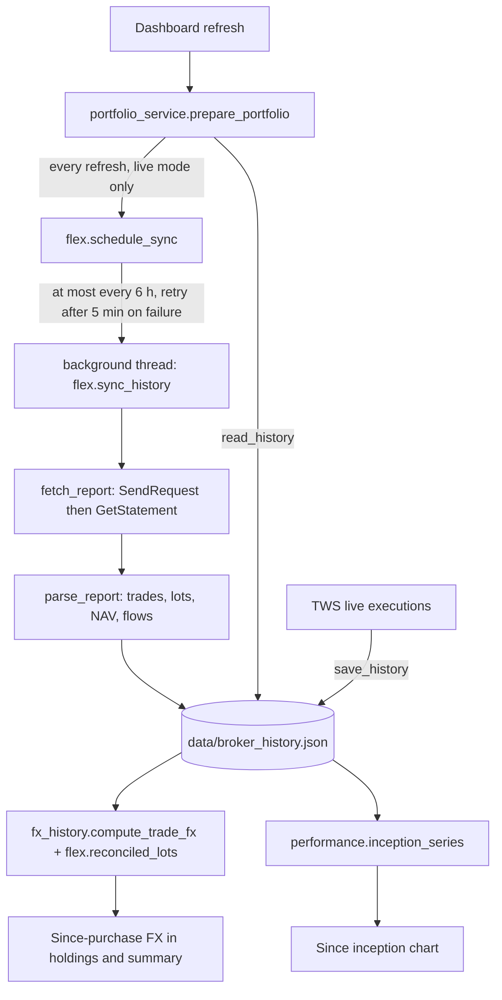

# How IBKR Flex Queries are used in this project

This page explains **why** the dashboard downloads IBKR Flex reports, **what** it
takes from them, and **where in the code** each part lives. For the one-time IBKR
setup steps (creating the query, token, environment variables) see
[DATA_AND_FLEX.md](DATA_AND_FLEX.md). For the overall file map see
[ARCHITECTURE.md](ARCHITECTURE.md).

Line numbers below were correct when this page was written; function names are
the stable reference.

## 1. Why Flex exists in this project

The dashboard's live data comes from TWS / IB Gateway through the API. That
connection is excellent for *now* (positions, prices, account value) but it
cannot answer questions about the *past*:

| Question | What the TWS API gives | What Flex adds |
|---|---|---|
| When and at what FX rate did I open each lot? | Only executions TWS still retains (the code comment at [ibkr.py:602](../backend/providers/ibkr.py#L602) says "not lifetime history") | Full execution history and **open lots with open dates** |
| What was my account worth each day? | Today's value only | **Daily NAV** (Net Asset Value in base currency) |
| When did I deposit or withdraw money? | Nothing | **Cash transactions** (deposits and withdrawals) |

Flex is IBKR's read-only reporting service. It needs only a reporting **token**
and a saved **query ID**: no trading permission and no username or password.

So Flex serves two features:

1. **Since-purchase FX impact**: how much of a foreign holding's gain or loss is
   due to currency moves since you bought it. Needs authoritative lots.
2. **"Since inception" performance**: the account's real time-weighted return,
   matching IBKR's own figure. Needs daily NAV and deposits.

Without Flex the dashboard still works. These two features report
"unavailable" with an explanation instead of guessing.

## 2. What the Flex query must contain

One saved **Activity Flex Query**, XML output, `yyyyMMdd` dates, `HHmmss` times.

| Section in IBKR's list | Detail level | Used for | Parsed by |
|---|---|---|---|
| Account Information | n/a | Account ID, base currency, **date opened** | [`parse_report`](../backend/providers/flex.py#L189) |
| Trades | **Executions** | Opening FX per lot, execution coverage | `parse_report` |
| Open Positions | **Lots** | Authoritative remaining lots and open dates | `parse_report` |
| Net Asset Value (NAV) in Base | by report date (`Total`) | Daily NAV for performance | [`_parse_nav`](../backend/providers/flex.py#L147) |
| Cash Transactions | **Detail**, Deposits & Withdrawals | External cash flows for performance | [`_parse_flows`](../backend/providers/flex.py#L161) |

Only the first three are required for the dashboard to start syncing. NAV and
Cash Transactions are optional for the sync but required for Since inception.

Things the parser deliberately does with the report:

- **`BookTrade` rows are skipped.** IBKR creates zero-price internal bookkeeping
  entries (no execution ID); they are not fills and would otherwise abort the
  whole sync.
- **Only `Deposits/Withdrawals` are external flows.** Dividends, interest and
  fees stay *inside* the return.
- **Strict parsing.** A genuine fill with a missing ID, quantity or price, or a
  deposit with no FX rate to base, raises an error. It is never silently dropped.

## 3. Configuration

| Setting | Where | Purpose |
|---|---|---|
| `IBKR_FLEX_TOKEN` | environment variable | Flex Web Service token (secret, never logged) |
| `IBKR_FLEX_QUERY_ID` | environment variable | The saved query's ID |
| `IBKR_REPORT_TIMEZONE` | environment variable | IANA zone of the report/TWS timestamps (for example `Europe/Athens`) |
| `IBKR_ACCOUNT` | environment variable | Pick one account when TWS exposes several ([ibkr.py:368](../backend/providers/ibkr.py#L368)) |
| `performance.start_date` | [config.yaml](../config.yaml), or env `PERFORMANCE_START_DATE` | Date "Since inception" counts from |

- The three `IBKR_FLEX_*` / timezone variables are read directly with
  `os.environ` in [`schedule_sync`](../backend/providers/flex.py#L327); they are
  not part of `config.yaml`.
- [docker-compose.yml:19-21](../docker-compose.yml#L19) forwards them into the
  container, and [.env.example](../.env.example) documents them. Python does not
  load `.env` by itself, so a native launch needs real environment variables.
- `performance.start_date` is defined in [config.py](../config.py) (default
  `None`, meaning the first NAV day). Docker Compose does not currently forward
  `PERFORMANCE_START_DATE`.

## 4. End-to-end data flow



The Flex download never blocks a page render: it runs on a one-worker
background thread, and the dashboard uses whatever is already stored.

## 5. Code map: where Flex is used

### The Flex provider: [backend/providers/flex.py](../backend/providers/flex.py)

| Function | Line | Role |
|---|---|---|
| `read_history` / `_validate_history` | [32](../backend/providers/flex.py#L32) / [41](../backend/providers/flex.py#L41) | Load and validate `broker_history.json`; refuse to overwrite a corrupt file |
| `save_history` | [81](../backend/providers/flex.py#L81) | Merge trades (by execution ID, with corrections and cancellations), lots, NAV, flows, coverage; atomic write |
| `report_datetime`, `_report_day` | [126](../backend/providers/flex.py#L126), [136](../backend/providers/flex.py#L136) | Timestamp and calendar-day parsing |
| `_parse_nav`, `_parse_flows` | [147](../backend/providers/flex.py#L147), [161](../backend/providers/flex.py#L161) | Daily NAV and external deposits/withdrawals in base currency |
| `parse_report` | [189](../backend/providers/flex.py#L189) | Turn one Flex XML statement into trades, lots, NAV and flows (rejects `DOCTYPE`, huge files, bad rows) |
| `_request`, `fetch_report` | [247](../backend/providers/flex.py#L247), [262](../backend/providers/flex.py#L262) | The two-step Flex Web Service call; surfaces IBKR error codes with the token masked |
| `StatementNotAvailable` | [258](../backend/providers/flex.py#L258) | IBKR error 1003: that day's statement is not built yet |
| `sync_history` | [283](../backend/providers/flex.py#L283) | Download the latest window, then backfill back to the account's open date |
| `schedule_sync` | [327](../backend/providers/flex.py#L327) | Throttle and run the sync in the background; holds the status text shown in the UI |
| `reconciled_lots` | [349](../backend/providers/flex.py#L349) | Combine authoritative lots with later fills; refuse to guess when they do not reconcile |

### Callers and consumers

| File | Line | How it uses Flex data |
|---|---|---|
| [backend/portfolio_service.py](../backend/portfolio_service.py) | [15](../backend/portfolio_service.py#L15), [82-89](../backend/portfolio_service.py#L82) | Saves live TWS fills into the history, loads the stored lot state, and triggers `schedule_sync` (skipped in demo mode) |
| [backend/portfolio_service.py](../backend/portfolio_service.py) | [99-105](../backend/portfolio_service.py#L99), [124](../backend/portfolio_service.py#L124) | Passes lot state and `executions_from` to the FX job; returns `history_status` in the payload |
| [backend/providers/fx_history.py](../backend/providers/fx_history.py) | [14](../backend/providers/fx_history.py#L14), [57-94](../backend/providers/fx_history.py#L57) | `compute_trade_fx` uses `reconciled_lots` to compute since-purchase FX per lot; reports why it is unavailable otherwise |
| [backend/providers/ibkr.py](../backend/providers/ibkr.py) | [603-632](../backend/providers/ibkr.py#L603), [752-757](../backend/providers/ibkr.py#L752) | Fetches live TWS executions (the recent window Flex has not covered yet) and sets `executions_from`, the boundary between Flex and TWS coverage |
| [backend/portfolio/performance.py](../backend/portfolio/performance.py) | [33](../backend/portfolio/performance.py#L33), [91](../backend/portfolio/performance.py#L91), [101](../backend/portfolio/performance.py#L101) | `twr_levels` (pure time-weighted return), `_configured_start`, `inception_series` (reads stored NAV and flows) |
| [ui/callbacks/performance.py](../ui/callbacks/performance.py) | [29](../ui/callbacks/performance.py#L29), [145](../ui/callbacks/performance.py#L145) | Builds the Since inception chart; shows the explanatory error if NAV or flows are missing |
| [ui/components/performance.py](../ui/components/performance.py) | period selector | Adds the **Since inception** option (the default period) |
| [ui/components/summary.py](../ui/components/summary.py) | [167](../ui/components/summary.py#L167), [242](../ui/components/summary.py#L242) | Shows `history_status` and the per-position reason when FX since purchase is unavailable |
| [backend/schemas.py](../backend/schemas.py) | [109](../backend/schemas.py#L109) | `history_status` field in the portfolio payload |
| [backend/storage/trades.py](../backend/storage/trades.py) | [42](../backend/storage/trades.py#L42) | The manual CSV upload fallback understands Flex's `20240115;093012` timestamps; `atomic_json` is the shared safe writer |
| [config.py](../config.py), [config.yaml](../config.yaml) | n/a | `performance.start_date` setting |

### Tests

| Test file | Covers |
|---|---|
| [tests/test_flex_history.py](../tests/test_flex_history.py) | Protocol, execution identity and corrections, persistence safety, lot reconciliation, sync windows, 1003 step-back, error masking |
| [tests/test_inception_performance.py](../tests/test_inception_performance.py) | NAV/flow parsing, TWR maths, start-date handling, BookTrade skipping, the chart |
| [tests/test_fx_trade_lot_precedence.py](../tests/test_fx_trade_lot_precedence.py), [tests/test_fx_impact.py](../tests/test_fx_impact.py) | Since-purchase FX built on the lots |

## 6. The sync lifecycle

1. **Trigger.** Each portfolio refresh in live mode calls `schedule_sync`. With
   the three variables unset it only sets the status "Set IBKR_FLEX_TOKEN …".
2. **Throttle.** At most one sync every six hours; a failed one retries after
   five minutes. Runs on a single background thread.
3. **Latest window first.** Up to 364 days ending *yesterday*. If IBKR answers
   error 1003 (yesterday's statement not built yet) the end date steps back one
   day, up to four times, and the chart simply ends on the newest day available.
   Once NAV is stored, later syncs only re-read from two days before the last
   report.
4. **Backfill.** Older windows (each at most 365 days) back to the account's
   `dateOpened`, using the coverage already stored to skip finished ranges.
5. **Merge and save.** Executions merge by IBKR execution ID so partial fills
   stay distinct and corrections replace originals; cancelled executions are
   kept as tombstones so an older report cannot resurrect them; NAV days and
   deposits merge by date and ID. Saves are atomic (temp file, flush, replace).

## 7. Where the data lives

`data/broker_history.json` (or `IBKRDASH_DATA_DIR`), private runtime data that
is never committed:

```text
{ "version": 1,
  "accounts": { "<account id>": {
      "trades": [ ... ],            # executions, live and Flex
      "lots":   [ ... ],            # open lots from the latest statement
      "report_end": "...",          # end of the latest lot snapshot
      "coverage": {"from", "to"},   # dates covered by Flex downloads
      "synced_at": "...",
      "nav":   {"2026-11-02": 99986.30, ...},   # base-currency NAV per day
      "flows": [{"day", "amount", "id"}, ...] } } }
```

## 8. How performance uses it

`twr_levels` computes, for each day:

```text
r(t) = NAV(t) / (NAV(t-1) + deposits(t)) - 1        level(t) = level(t-1) × (1 + r(t))
```

- Cash is part of NAV, so uninvested cash drags the return exactly as in IBKR.
- With `performance.start_date`, the base is the last NAV **before** that date,
  so the start day's own move counts, as in an IBKR report for a period that
  begins that day.
- The older holdings backcast in `backend/portfolio/history.py` and
  `analysis.py` is a different thing: today's weights applied backwards. It is
  still used for 1M to 5Y and Custom; only **Since inception** uses Flex.

## 9. Design decisions

- **Read-only.** The token can only download reports.
- **Secrets stay out of logs and messages.** Request URLs contain the token, so
  transport errors are rewritten and IBKR messages have the token masked.
- **Fail closed, never guess.** Missing sections, unreconciled lots or a
  coverage gap produce "unavailable" with a reason, not a plausible number.
- **Off the request path.** Dashboard pages never wait for a Flex download.
- **One source of truth on disk.** Everything Flex gives is saved once in
  `broker_history.json`; UI, Coach and PDF read the same stored result.

## 10. Troubleshooting

| Message | Meaning and action |
|---|---|
| "Set IBKR_FLEX_TOKEN, IBKR_FLEX_QUERY_ID and IBKR_REPORT_TIMEZONE …" | Variables not visible to the app; set them in the window that starts it |
| "No daily NAV from Flex yet …" | Add Net Asset Value (NAV) in Base to the query and wait for a sync |
| "No deposit history from Flex yet …" | Add Cash Transactions at Detail level |
| IBKR error 1003 | Statement for that day not ready; the sync retries earlier days automatically |
| IBKR error 1012 | Token expired; generate a new one |
| IBKR error 1013 | Token IP restriction blocks this computer |
| IBKR error 1014 / 1015 | Wrong query ID / wrong token |
| IBKR error 1018 | Too many requests for this token; wait a few minutes |
| "Flex execution identity, quantity or price missing" | A real fill row is incomplete; check the query's Trades fields |
| "Open-lot history coverage gap …" | Needs a newer Flex statement before since-purchase FX is shown |

## 11. Known limits

- Demo mode (`--demo`) never syncs Flex.
- The chart ends on the last day IBKR has built, not intraday.
- Several accounts: set `IBKR_ACCOUNT`; accounts are never combined.
- Flex gives at most a 365-day window per request; very old history is
  retrieved in several requests and IBKR rate-limits each token.
- Transfers and corporate actions can prevent lot reconciliation; the affected
  position shows an explanatory reason instead of a number.
